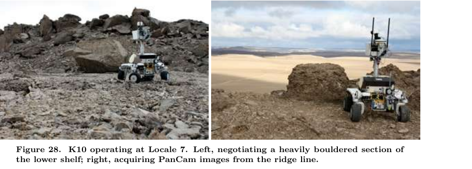
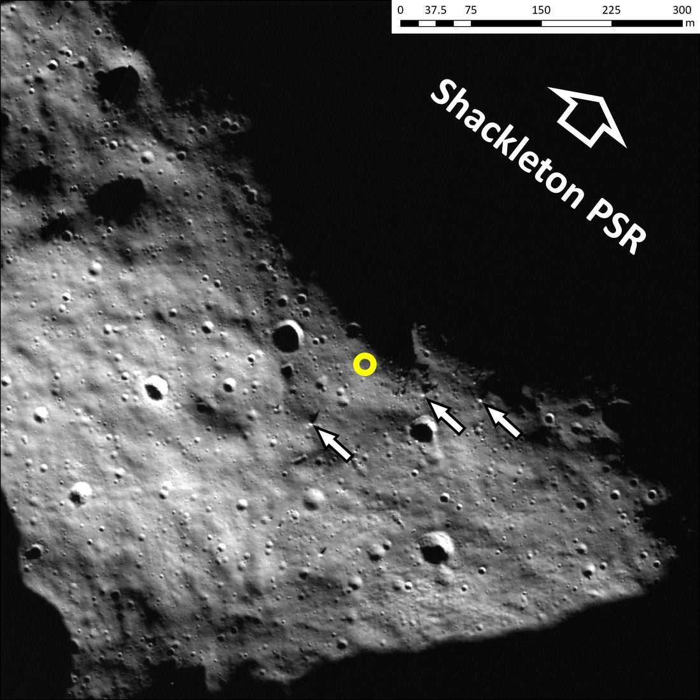

# P01 visual evidence: Haughton Locale 7 and Shackleton rim

These source images support the qualitative P01 desk review in [source.md](../../source.md). Show each image with its own caption, credit, and scale label. Their displayed sizes do **not** imply equal ground scale. Neither image supplies a verified polygon or a safe traverse route.

## Earth: Haughton Crater, Locale 7

**Display label:** Haughton Locale 7 field photographs. **Ground scale unavailable**; the rover gives visual context but is not a calibrated ruler. This is an oblique ground view, not an overhead terrain map.

**Credit and source:** Fong et al., *Robotic Follow-up for Human Exploration* (2010), Figure 28, printed page 20, [NASA NTRS 20110008151](https://ntrs.nasa.gov/citations/20110008151). The image is a region rendered from the published PDF and retains its original figure caption.

**Reuse:** The [NTRS record](https://ntrs.nasa.gov/citations/20110008151) marks the report “Public Use Permitted.” NASA's [STI terms](https://sti.nasa.gov/disclaimers/) explain that separately copyrighted material can be embedded in a report; no separate restriction was found on this figure. Preserve attribution and reassess rights if using it outside this educational/informational project.

## Moon: Shackleton–de Gerlache ridge intersection

**Display label:** Shackleton rim detail, **750 m scene width**; the source image includes a **0–300 m scale bar**. The source places the scene at **89.684°S, 196.739°E** (positive east). The arrows mark blocks interpreted as likely ejecta; the yellow circle is an indicated observation area, not a validated safe site.

**Credit and source:** NASA/GSFC/Arizona State University, LROC, [*Traversing the Shackleton–de Gerlache Ridge*](https://lroc.im-ldi.com/images/1247) (2022). The saved PNG is the source site's annotated image, without redrawn features or rescaling.

**Reuse:** The [LROC terms](https://lroc.im-ldi.com/about/terms) permit attributed educational use of featured images. The image remains copyrighted; commercial use of this non-PDS image requires permission.

## Comparison limit

The Earth photographs are close ground views with unknown ground width. The lunar image is an overhead orbital view with a published scale. Use them to illustrate cited obstacles and mapping questions; do not derive matching block sizes, slopes, distances, or a numeric similarity score from visual juxtaposition.
